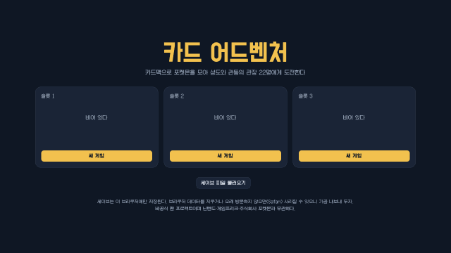

# 카드 어드벤처

하트골드 스토리를 따라가는 **카드 가챠 + 갈림길 지도** 웹게임입니다.
몬스터볼 대신 카드팩으로 포켓몬을 모으고, 챕터마다 갈림길 지도를 지나 관장에게 도전합니다.



**진행 상태**: MVP — 1~2장(관장 비상, 호일)을 처음부터 끝까지 플레이할 수 있습니다. 같은 틀로 22장까지 넓혀 갑니다.

## 게임 흐름

1. **새 게임**: 난이도 4종(쉬움 / 보통 / 어려움 / 익스트림)과 챌린지(너즐록, 랜덤 스타터)를 고릅니다. 시작한 뒤에는 바꿀 수 없습니다.
2. **스타터 팩**: 1~9세대 스타터 27종 중 서로 다른 5장에서 1장을 고릅니다.
3. **챕터 지도**: 아래에서 위로 갈림길을 골라 올라갑니다. 야생 · 트레이너 · 엘리트 · 상점 · 휴식 · 보상 · 사건(?) 노드를 지나 꼭대기의 관장에게 도전합니다.
   - **보상**: 지닌 도구 3개 중 1개를 골라 가져갑니다(생명의구슬, 울퉁불퉁멧, 자뭉열매 등 64종).
   - **사건**: 짧은 이야기와 선택지. 도구를 얻거나, 승부가 벌어지거나, 쉬어 가거나, 골드를 내고 지나갑니다.
4. **전투**: 원작 공식 그대로의 싱글배틀. 이기면 경험치를 받고 진화하며, 보상으로 **속성 팩**을 골라 5장을 모두 받습니다.
5. **카드 성장**: 같은 진화 계열 카드는 자동으로 합쳐져 ★등급이 오르고, 등급마다 받는 개체값 포인트를 직접 배분합니다(31 도달 스탯은 최대 2개).
6. **저장**: 브라우저에 슬롯 3개로 자동 저장되고, 세이브 파일로 내보내고 불러올 수 있습니다.

## 설계에서 신경 쓴 것

### 순수 함수 전투 엔진 + 연출 이벤트
- `battle(state, action, dex) → newState`. React·브라우저에 의존하지 않는 순수 TypeScript이고, 시드 난수로 **같은 입력이면 항상 같은 결과**가 나옵니다.
- 데미지 공식의 내림·0.5 반올림 순서, 급소 랭크, 상태이상, 타입 면역까지 원작과 맞추고 테스트로 고정했습니다.
- 엔진은 결과 상태와 함께 **연출 이벤트 목록**(데미지·회복·상태이상·랭크·기절·메시지)을 내보냅니다. 화면은 이전 상태에서 출발해 이벤트를 하나씩 재생하고, "이벤트만 재생해도 최종 HP·로그가 엔진 결과와 같은지"를 무작위 전투 100판으로 검증합니다.

### 데이터 파이프라인
- PokeAPI CSV와 하트골드 디스어셈블리([pret/pokeheartgold](https://github.com/pret/pokeheartgold))에서 **종 1025개, 기술 920개, 원작 트레이너 724명**, 진화·기술머신 호환·야생 출현표를 스크립트로 생성합니다.
- 생성된 JSON은 손으로 고치지 않고, 수동 보정은 `src/data/overrides/`에 두어 스크립트가 반영합니다. 데이터끼리 참조가 맞는지(종·기술 id, 출현 확률 합 100% 등)는 테스트로 검사합니다. PokeAPI가 기술 이름을 바꿔 매핑이 조용히 깨진 일을 계기로 넣었습니다.

### 밸런스를 숫자로 맞추기
실제 게임과 같은 스토어·엔진으로 1~2장을 끝까지 플레이하는 **자동 플레이 봇**(`npm run sim`)을 만들어, 감이 아니라 클리어율로 조정했습니다. 봇은 지도에 보이는 상대 전력을 보고 이길 만한 노드를 고르고, 한 번 진 노드는 피합니다.

| 난이도 | 1장 클리어 | 평균 재시작 | 2장 클리어 |
|---|---|---|---|
| 쉬움 | 30 / 30 | 0.1 | 30 / 30 |
| 보통 | 29 / 30 | 1.4 | 28 / 29 |
| 어려움 | 20 / 30 | 1.3 | 13 / 20 |
| 익스트림 | 13 / 30 | 4.6 | 9 / 13 |

봇을 돌리면서 찾은 것들:
- 상대 AI가 변화기에 고정 점수를 줘서, 데미지가 작은 초반에 **울음소리만 반복**하던 버그
- 보상 카드가 늘 Lv6이라 챕터 후반의 새 카드가 쓸모없던 문제 → 쓰러뜨린 상대 레벨 기준으로 변경
- 익스트림 초안 수치로는 30판 중 한 번도 이기지 못하던 문제 → 레벨 보정과 레벨 캡을 풀고 재대결 관장으로 어렵게

### 저장
- 진행 상태가 바뀌면 모았다가 자동 저장하고, 창을 닫거나 숨길 때도 저장합니다.
- **진행 중이던 노드는 저장하지 않습니다.** 전투 도중에 닫으면 그 노드에 들어가기 전으로 돌아가서, 같은 노드를 반복해 보상을 얻을 수 없습니다. 이긴 뒤 열지 않은 보상 팩은 저장해 그 화면부터 이어집니다.
- 세이브는 버전과 형식을 검사한 뒤 불러오고(파일 가져오기 포함), 저장소 접근은 한 파일로 모아 나중에 클라우드로 바꿀 수 있게 했습니다.

## 기술 스택

React 19 · TypeScript · Vite · Tailwind CSS v4 · Zustand · Framer Motion · Vitest

## 구조

```
src/
├─ core/       순수 TypeScript 게임 규칙 (React·브라우저 API 의존 없음, 모두 테스트)
│  ├─ battle.ts      전투 엔진 + 상대 AI
│  ├─ card.ts        ★등급, 개체값 포인트, 중복 합치기, 기술 장착
│  ├─ gacha.ts       시드 난수, 팩 개봉, 자동 합치기
│  ├─ progress.ts    경험치, 레벨업, 기술 습득, 진화
│  ├─ map.ts         갈림길 지도 생성 (교차 없는 연결)
│  ├─ encounter.ts   노드별 상대와 보상
│  ├─ difficulty.ts  난이도 보정
│  ├─ items.ts       회복약, 기술머신, 상점
│  ├─ heldItems.ts   지닌 도구 효과 표, 지니기, 보상 뽑기
│  ├─ events.ts      사건 노드
│  └─ save.ts        세이브 검사·마이그레이션
├─ store/      Zustand 스토어, 저장소, 자동 저장
├─ features/   화면 (타이틀, 지도, 전투, 팩, 보관함, 카드 상세, 상점, 휴식 …)
├─ sim/        밸런스 측정용 자동 플레이 봇
└─ data/       스크립트가 생성한 JSON (수동 보정은 overrides/)
scripts/       데이터 생성 스크립트
docs/          기획서(spec.md), 에셋 목록
```

설계와 규칙의 기준은 [docs/spec.md](docs/spec.md)입니다.

## 실행

```bash
npm install
npm run dev     # 개발 서버
npm test        # 테스트 (183개)
npm run sim     # 밸런스 측정 (난이도별 자동 플레이)
npm run build   # 타입 체크 + 빌드
```

전투 연출만 확인하려면 주소에 `?test=battle&moves=ice-beam,earthquake`처럼 붙이면 됩니다.

## 에셋

포켓몬 스프라이트는 [PokeAPI/sprites](https://github.com/PokeAPI/sprites) URL을 직접 불러옵니다.
그 밖의 이미지(관장, 배지, 노드 아이콘, 지도 배경, 기술 이펙트)는 저장소에 포함하지 않으며, 없으면 색 테두리와 글자로 된 기본 표시로 대체됩니다. 시연 GIF도 이 기본 표시로 녹화했습니다.

## 데이터 출처

- [PokeAPI](https://github.com/PokeAPI/pokeapi): 종, 기술, 상성, 경험치, 진화, 기술머신, 야생 출현, 지닌 도구 이름·설명
- [pret/pokeheartgold](https://github.com/pret/pokeheartgold): 트레이너 파티

## 라이선스

코드는 [MIT](LICENSE)입니다. 포켓몬 관련 이름, 데이터, 이미지의 권리는 각 권리자에게 있으며 MIT 라이선스 대상이 아닙니다.
